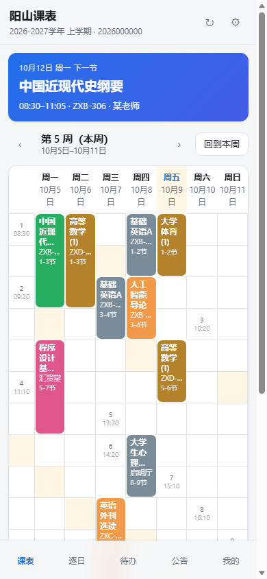

# 仰山课表

北京信息科技大学本科教务系统的课表，变成一张**在你手机上随时能看、能提醒、能导进系统日历**的周课表。

不用注册、不用连服务器、不用把账号密码交给任何人。抓一次，之后断网也能看。



> 截图用的是仓库里的脱敏样本（`test/fixtures/raw-2026-2027-1.json`，真实抓取结果洗掉姓名学号后的版本）。

---

## 目录

- [它长什么样](#它长什么样)
- [怎么用](#怎么用)
- [桌面与手机客户端（壳）](#桌面与手机客户端壳)
- [为什么非得这么设计](#为什么非得这么设计)
- [隐私](#隐私)
- [功能对照](#功能对照)
- [能做的和做不到的](#能做的和做不到的)
- [发公告（管理员）](#发公告管理员)
- [开发](#开发)
- [项目结构](#项目结构)
- [常见问题](#常见问题)
- [复盘：这个项目上踩过的坑](docs/复盘.md)

---

## 它长什么样

三个产物，同一个网页内核：

| 产物 | 给谁用 | 怎么拿到 |
| --- | --- | --- |
| `仰山课表.html` | 所有人。**一个文件就是全部**（约 10MB，因为把截图 OCR 的引擎和中文语言包一起内联了），双击打开即用、断网可用 | [Releases](../../releases) 下载 |
| `dist/site/` | iOS / 鸿蒙用户。托管成 PWA，加到桌面像原生 App，能离线；首页只有 200KB，OCR 资产放 `ocr/` 按需取 | **已托管**：[chen-ser.github.io/YangShan-schedule](https://chen-ser.github.io/YangShan-schedule/)（推 `main` 自动发布） |
| **Windows 壳**（`shells/windows/`） | 想要「输一次账号，之后每小时自动更新」的 Windows 用户 | 自己编译（约 160KB 的 exe，把 10MB 内核打在程序集里） |
| **安卓壳**（`shells/android/`） | 同上，安卓手机 | 自己编译 APK（**已编译验证**，产物 9.24 MB） |
| 抓取书签 | iOS / 鸿蒙用来把课表数据弄进网页 | 网页内「我的 → 抓取课表」复制 |

五个页面：**课表**（周视图）、**逐日**、**待办**、**公告**、**我的**。

**在线地址**：[**chen-ser.github.io/YangShan-schedule**](https://chen-ser.github.io/YangShan-schedule/)

> ⚠️ **大小写不能改**。仓库的规范名是 `YangShan-schedule`（大写 Y、大写 S）。github.com 的仓库网址大小写不敏感，但 **GitHub Pages 的路径敏感** —— 全小写的 `/yangshan-schedule/` 会返回 404。这个坑实际踩过一次。

托管版由 GitHub Actions 自动发布（推 `main` 即部署，部署前先跑一遍测试）。手机浏览器打开上面的地址
→ 「添加到主屏幕」→ 桌面上就多一个仰山课表，能离线打开，不用装任何 App。
打标签（`v*`）会额外出一个 Release，把 10MB 的单文件版挂上去给同学直接下载。

**手机端怎么用**（iOS / 鸿蒙，不需要装任何东西）见 [docs/install-mobile.md](docs/install-mobile.md)。

---

## 怎么用

### 第一步 · 拿到课表

点「导入课表」有四条路。**数据都只落在这台设备上**，下面四条没有一条会把它传出去。

| | 入口 | 在哪能用 | 要你做什么 |
|---|---|---|---|
| ① | 登录教务系统 | **只有客户端**（Windows / 安卓） | 填一次学号密码 |
| ② | 上传课表文件 | 四端都能用 | 在教务系统点「导出」，把 .xlsx / .docx 存下来 |
| ③ | 课表截图 | 四端都能用 | 选一张截图，**自动识别**，然后核对一遍 |
| ④ | 粘贴抓取结果 | 四端都能用 | 用书签小工具抓一次 |

#### ② 上传课表文件（最推荐）

教务系统的课表页上有「导出」，能存成 Excel 或 Word。把它拖进「上传课表文件」就行。

> ★ **这条路拿到的课表可能比自动抓取还全。** 实测同一个学生的同一学期：接口返回 22 条、展开 133 节课；导出的文件里多出「程序设计基础(C语言)B」第 14–17 周那段（还换了教室），展开 137 节课。
> **文件导入不是降级方案，它是主力方案。**

文件里只有「第几周」，没有学期从哪天开始，所以会问你一次「今天是第几周」—— 填 5，它自己算出第 1 周的星期一是 `2026-09-07`。教务系统首页或课表页上写着这个数字。

#### ④ 抓取书签（手机上唯一能全自动的路）

**电脑（Chrome / Edge）**

1. 打开 `仰山课表.html`，进「我的 → 抓取课表」
2. 把里面那个 **📌 抓取课表** 按钮**拖到书签栏**
3. 打开 `https://jwxt.bistu.edu.cn`，正常登录，进到课表页面
4. 点一下书签栏里那个按钮 —— 页面角落会冒出一个小面板，显示抓到了什么
5. 数据自动进了剪贴板（没成功的话面板里有个全选好的框，手动 Ctrl+C）
6. 回到 `仰山课表.html`，「导入课表 → 粘贴抓取结果」，粘贴，导入

**手机（iOS Safari / 安卓 / 鸿蒙浏览器）**

同上，只有第 2 步不同：没法拖拽，得**复制书签链接 → 手动新建一个书签 → 把链接粘进地址栏**。

> ⚠️ iOS Safari 会拦掉你在地址栏里手打的 `javascript:`。**必须存成书签再点**，这是唯一能绕过去的办法。

#### ① 登录教务系统 —— 为什么网页里做不到

不是没做，是浏览器的安全规则不允许，两道墙：

1. 课表网页在第三方域名下，请求教务系统接口属于**跨源请求**。教务系统的接口不回 `Access-Control-Allow-Origin`，浏览器就不会把响应交给网页 —— 连响应体都读不到。
2. 登录会话的 cookie 缺省是 `SameSite=Lax`，跨站请求根本不会带上。

所以纯网页端点了这一项会**解释原因并给出上面三条替代路**，不静默失败。装了客户端之后，客户端自己在原生层发请求（没有同源策略这回事），这一项才会真的出现登录框。

#### ③ 课表截图（全自动识别，认完请核对一遍）

选一张课表截图（手机上会直接让你拍照），**在这台设备上离线识别**，图不上传。识别结果会直接铺进可编辑的格子，你扫一眼改掉错字再保存。

- **引擎**：`tesseract.js` + `chi_sim` / `eng` 语言包，全都随页面走。单文件版把它们内联在 HTML 里（所以那个文件有 10MB —— 「软件大小无所谓，直接全自动」）；托管版放在 `ocr/` 目录按需取，取过一次就被 Service Worker 缓存住。
- **为什么必须能改**：中文表格的 OCR 准确率到不了 100%，实测**错的几乎全是课名**（`高等数学(1)` 会认成 `高等数学(D)`、`人工智能导论` 会认成 `外区各能导论`），星期、节次、周次、教室这些**结构信息基本不出错**。所以定位是「出草稿」而不是「出结果」。
- **识别参数**：`tessedit_pageseg_mode = 11`（SPARSE_TEXT）+ **原图彩色、不做任何预处理**。实测灰度化和 2 倍放大都更差（课表格子有底色，去色反而糊成一团）。
- **几何怎么归格子**：tesseract 的 TSV 里 `level 4`（行）的文本字段是**空的**，而且同一横排上分属两列的字会被并成一行（`中国近‖高等数` 横跨星期一和星期二）。所以分列**只能靠词框**：拿「星期X」的 `left` 推列心与步距，「第N节」的标签推节次带，再按列内**纵向间隙**把词聚成块归带。见 `core/ocrgrid.mjs`。
- **认不出来怎么办**：会明说是哪一步卡住（没认到字 / 没找到「星期一…星期日」表头 / 没找到「第 N 节」那一列），并给出退路 —— 系统识字后粘贴，或者手动填格子：iOS 的「实况文本」、安卓相册「提取文字」、鸿蒙长按、微信长按图片、Windows 的 PowerToys（`Win+Shift+T`）。
- **实测**：一张 780×1800 的模拟课表截图（7 天 × 11 节）在无头 Edge 里**从选中图片到铺满格子 1.8 秒**，认出 10 门课；`stats = { columns: 7, sections: 11, courses: 10, words: 179 }`。全部 10 门的星期 / 节次 / 周次 / 教室都对，出错的只有 4 个课名里的字（`高等数学(1)`→`高等数学(D)`、`人工智能导论`→`外区各能导论`、`大学生心理健康`→`大学生心理健`）。
- **有课表文件就别截图**：教务系统导出的 `.xlsx` / `.docx` 是 100% 准确的，优先用它。

> ★ 截图认出来的格子**没有第二套解析逻辑**：它拼成和导出文件同形的表格，喂给同一个 `parseScheduleGrid`。所以截图导入的课表和文件导入的课表在日历里是**同一条事件（UID 相同）**，以后改用文件导入不会出现两份。

> ★ 手动填的那一格**没有第二套解析逻辑**：它拼成和导出文件同形的表格，喂给同一个 `parseScheduleGrid`。所以手动填的课表和文件导入的课表在日历里是**同一条事件（UID 相同）**，以后改用文件导入不会出现两份。

### 第二步 · 放在桌面上

- **iOS**：Safari 打开 → 分享 → 「添加到主屏幕」
- **鸿蒙 / 安卓**：浏览器菜单 → 「添加到桌面」
- **Windows**：Edge 打开 → 右上角 ⋯ → 应用 → 安装此站点

加完之后就是全屏、有图标、断网也能打开的样子。

### 第三步 · 上课提醒（可选）

网页本身**没法在后台准时响铃** —— 浏览器会把定时器和 Service Worker 掐掉。真提醒得靠系统日历：

「我的 → 导出 .ics」→ 发给手机 → 打开 → 系统日历接管，然后每节课都会按系统提醒响。

想要**改课表后自动更新**（不用重新导入），把 `.ics` 发到你自己的 GitHub 仓库，用 `webcal://` 链接订阅即可 —— 见[常见问题](#改了课表怎么办)。

---

## 桌面与手机客户端（壳）

网页版有一个天生的缺口：**它没法自己去教务系统抓数据**（原因见下一节），也没法在后台定时更新。
「壳」就是补这两个缺口的一层薄包装 —— 它是一个自带浏览器内核的原生程序，
把课表网页装在里面显示，并替它去学校页面上跑一次抓取。

| 壳 | 状态 | 目录 |
| --- | --- | --- |
| Windows（WinForms + WebView2） | **已编译、已安装、已通过界面自检**（10.5MB 内核打进程序集，经 `https://yangshan.local/` 虚拟源加载，双向通信、localStorage、导入入口六项全过；`install.ps1` 会建开始菜单与桌面快捷方式并写卸载项） | [`shells/windows/`](shells/windows/) |
| 安卓（Kotlin + WebView + WebViewAssetLoader） | **已编译验证**：`gradle assembleDebug` 通过，APK **9.59 MB**（10,057,290 B，SHA256 `7F4153E9…`），含 [公告推送前台服务](#关掉-app-也能收到公告只有安卓)。**真机安装运行尚未验证**（构建机上没有 adb 设备） | [`shells/android/`](shells/android/) |

### 一份抓取逻辑，三处共用

以前抓取代码只活在书签小工具里，壳要用就得复制一份 —— 两份早晚各自漂移。
现在 [`shells/capture.js`](shells/capture.js) 是**唯一实现**：

```
shells/capture.js  ─┬─→  web/build.mjs 拼进 dist/bookmarklet.txt（书签小工具）
                    ├─→  shells/windows  <EmbeddedResource> 内嵌进 exe
                    └─→  shells/android  拷进 assets/，在学校窗口里注入
```

壳与网页之间只走一个约定好的接口：

```js
globalThis.YangShanShell = {
  name: 'windows' | 'android', version: 1,
  login(username, password), refresh(), status(), forget(),
  notify(title, body), openExternal(url),
  setAnnPush(topic, annUrl, base)   // 只有安卓壳认它；Windows 壳收到会忽略
}
```

网页侧读得到它 → 登录框真的能填；读不到 → 走一段解释「浏览器为什么做不到」的降级文案。
这段胶水在 [`shells/shim.js`](shells/shim.js)，两个壳共用（Windows 走 `chrome.webview.postMessage`，
安卓走 `@JavascriptInterface`，不对称的部分由 shim 内部吸收）。

### 关掉 App 也能收到公告（只有安卓）

网页里那条 `EventSource` 只在**页面活着**时有效 —— 手机锁屏、切走、从最近任务里划掉，它就没了。
要做到「App 关掉还能收到」，安卓壳里有一个前台服务 [`AnnPushService.kt`](shells/android/app/src/main/java/dev/yangshan/schedule/AnnPushService.kt)：
它自己维持一条到 `ntfy.sh/<频道>/sse` 的长连接，收到门铃就弹系统通知。

为什么非得是前台服务（而不是 FCM 或 WorkManager）：

| 路 | 为什么走不通 |
| --- | --- |
| FCM（Chrome/Edge 的 Web Push 也走它） | **在校园网里连不通** —— 实测 `fcm.googleapis.com` 直连 10 秒超时，而 `ntfy.sh`、`web.push.apple.com` 都通 |
| WorkManager 周期任务 | 最快 15 分钟一轮，公告晚一刻钟就没什么意义了 |
| 前台服务 | 唯一可行的路。代价是通知栏常驻一条 —— 它走 `IMPORTANCE_MIN` 的**独立渠道**，用户可以在系统设置里只把它静音、保留公告提醒 |

配套的三件事，缺一件就会「有时候收得到有时候收不到」：

- `START_STICKY` —— 被系统因内存回收杀掉后自己回来；
- `BootReceiver` —— 重启手机后把服务重新拉起来（否则重启一次就永久失效）；
- 网页端在保存「公告源」时把频道**下发**给壳（`shim.setAnnPush`），并在设置页如实回显状态
  （读不到就写「⚠️ 后台推送没起来，重开一次 App」——用户以为开了其实没开，是最糟的状态）。

**已知限制**：Android 15 起 `dataSync` 类型的前台服务每天累计最多约 6 小时，超时后系统会调
`Service.onTimeout`，服务会主动停下并弹一条「公告推送已暂停」。这是系统的省电策略，
不是本项目的缺陷；重新打开一次 App 即可恢复。

### 自己编译

```bash
# Windows
node web/build.mjs                     # 先生成内核
cd shells/windows
dotnet build -c Release                # 需要 .NET 10 SDK 与 WebView2 运行时
# 产物：bin/Release/net10.0-windows/YangShanShell.exe

# 安卓
node shells/android/tools/prepare-assets.mjs
# 然后用 Android Studio 打开 shells/android/，或 gradle assembleDebug
```

`shells/windows/build.ps1` 把这几步串起来了一次跑完（它还包含本机沙箱里
`dotnet restore` 走不通 HTTPS 时用本地 nupkg 源兜底的做法，普通联网环境不需要）。

壳的验证不靠肉眼，靠它自己的两个自检开关：

```bash
YangShanShell.exe --selfcheck        # 内核有没有打进去、WebView2 在不在、数据目录能不能写
YangShanShell.exe --uitest           # 真开一次窗口，逐项验证内核就绪 / 桥 / localStorage / 往返通信
```

`--uitest` 会写一份逐项打勾的报告（`--out <文件>` 可指定位置），**退出码 0 才算过**。
`--selfcheck` 是把结果打回调用它的控制台；在把 GUI 程序当子进程跑的自动化环境里，
它可能反过来把调用方挂住（PowerShell 不等 WinExe、控制台附着行为不一致），那种场合请用 `--uitest`。

### 装到自己机器上（Windows）

```powershell
powershell -ExecutionPolicy Bypass -File shells\windows\install.ps1
```

它做四件事：把 `out\` 拷到 `%LOCALAPPDATA%\Programs\YangShanSchedule`、建开始菜单
（`开始菜单\程序\仰山课表\`）与桌面快捷方式、写一条 HKCU 卸载项（于是能在
「设置 → 应用」里正常卸载）、启动程序。`-NoLaunch` 只装不启动，`-NoDesktopShortcut` 不建桌面图标，
`-Source <目录>` 指定别的构建产物目录。

卸载：

```powershell
powershell -ExecutionPolicy Bypass -File "$env:LOCALAPPDATA\Programs\YangShanSchedule\uninstall.ps1"
```

卸载会顺手清掉凭据管理器里记住的学校账号；**课表数据默认保留**（想连数据一起删就加 `-PurgeData`）。
`-Quiet` 供「应用和功能」静默调用。

---

## 为什么非得这么设计

**一句话：课表网页永远没法自己去教务系统抓数据。**

浏览器有同源策略。github.io 上的网页想 `fetch` 一个 `jwxt.bistu.edu.cn`：

1. 请求会带上 `Origin: https://xxx.github.io`
2. 教务系统不会回 `Access-Control-Allow-Origin` 这个头
3. 浏览器直接把响应丢掉 —— **连响应体都拿不到**
4. 就算第一条过了，还有 Cookie：跨站要 `SameSite=None; Secure`，学校系统不会这么配

这不是「写法不对」，是浏览器安全模型的硬边界。**任何「云端网页自动抓课表」的方案都是假的。** 所谓免费的 GitHub Pages 也只是静态托管，它不能跑后端、不能代理请求，帮不上忙。

所以正确的做法是反过来：**让代码跑到教务系统自己的页面里去。**

```
教务系统的页面（同源）
  └─ 点一下书签 → 注入的 JS 读三个接口 → 把「原始响应」塞进剪贴板
                                            ↓ 粘贴
                                 仰山课表.html（本地）
                                    └─ 解析 → 展开成每节课 → 渲染
```

三个接口（都是强智 EMAP 的原生 JSON 接口，不用爬 HTML）：

| 接口 | 拿什么 |
| --- | --- |
| `GET /jwapp/sys/homeapp/api/home/currentUser.do` | 当前学期代码、学号 |
| `POST /jwapp/sys/kbbpapp/api/schoolCalendar/getTermWeeks.do` | 19 周的起止日期 |
| `POST /jwapp/sys/homeapp/api/home/student/getMyScheduleDetail.do` | 22 条课程 + 5 条未排课 |

### 一个刻意的设计：书签只交原始响应

书签小工具**不做任何解析**，它只把教务返回的 JSON 原样打包（`YSRAW1-` + base64url）丢出来。所有解析、展开、去重规则都在网页里。

好处是：**教务系统改了字段、我们改了算法，用户不用重新存一次书签。** 只需要更新网页。

### 数据契约

抓取端和渲染端之间只有一个结构：

```jsonc
{
  "kind": "yangshan-raw",
  "schema": 1,
  "capturedAt": "2026-10-09T12:00:00.000Z",
  "currentUser":   { /* currentUser.do 的原始响应 */ },
  "termWeeks":     { /* getTermWeeks.do 的原始响应 */ },
  "scheduleDetail":{ /* getMyScheduleDetail.do 的原始响应 */ }
}
```

Windows / 安卓的内置浏览器壳注入的也是这个 —— **三条路径共用同一份 schema**，所以手机抓的数据可以发给电脑，反过来也行。

---

## 隐私

这是这个项目唯一值得吹的地方：

- **没有服务器。** 没有后端、没有数据库、没有账号体系，也就没有可以被拖库的东西、没有备案、没有运维成本。
- **网页版的账号密码不出本机。** 书签跑在教务系统自己的页面里，用它自己的登录态；你的密码从来没有经过这个项目的任何代码。
- **壳里的密码也只在本机、只发给学校。** 壳要替你登录，所以它确实会经手密码 —— 它做的是：在**学校自己的登录页面上**用原生输入事件填表并提交（`sso.bistu.edu.cn`），我们这边**没有**任何一行代码向其它地址发过密码。存的话只存进系统的凭据仓库（Windows 凭据管理器 / Android `EncryptedSharedPreferences`，密钥在 Keystore 里），**不写明文文件、不进日志、不上传**。不想存就别勾「记住账号」。
- **课表只存在浏览器本地**（`localStorage`）。
- **仓库里的样本是脱敏的。** `test/fixtures/raw-2026-2027-1.json` 由 `mkanon.mjs` 从真实响应生成，学号、姓名、教师名、内部编码全部置换，并且脚本会自检「一个不剩」才允许写出。

> ⚠️ **唯一的例外是「分享码」。** 它把课表打包成一段字符串方便你发给同学 —— **里面有你的学号和上课地点**。别往群里发。

---

## 功能对照

对着「一键导入 / 自动生成周课表 / 上课提醒 / 作业提醒 / 网课截止提醒 / 微信通知导入 / 图片识别 / 共享通知 / 公告栏 / 实时更新」这十项逐条落位。**做完了的写清怎么用，没做全的写清差在哪、为什么。** 不写"基本支持"这种话。

| 要的功能 | 状态 | 怎么用 / 差在哪 |
| --- | --- | --- |
| 一键导入 | ✅ | 四种入口：**登录教务**（仅客户端壳，见下）/ **上传课表文件** / **课表截图** / **粘贴抓取结果·分享码**。壳里点一次「登录并抓取」就是真·一键 |
| 总课表自动生成周课表（按日期） | ✅ | 教务的周次位图 + 每学期周历 → 展开成**带具体日期**的每一节课。周视图按当前日期自动定位到本周，逐日视图带日期选择器 |
| 自动设置上课提醒 | ✅ | 两路：① 导出 `.ics`（带 `VALARM`），交给系统日历 —— **这条是可靠的**；② 应用内弹窗，页面开着才响。设置里选提前 5/10/15/30 分钟 |
| 导入作业后自动设置作业提醒 | ✅ | 待办页「粘贴通知文本解析」或手动加 → 到点前弹窗提醒（默认提前 30 分钟，可关）→ 导出 `.ics` 时作为带 `VALARM` 的事件一起导出（默认提前 1 天）。已勾掉的待办不再提醒、也不导出 |
| 网课截止提醒 | ✅ | 同上，且导入时会按关键字**自动分类**成「网课」（另有 作业 / 考试 / 其他），四类在列表里颜色不同 |
| 微信通知导入后自动设置事件提醒 | ⚠️ 半自动 | 「导入 + 自动分类 + 自动提醒」都做好了，**但"自动读微信"做不到**：微信不把聊天记录给任何第三方读。流程是你在微信里长按那条通知 → 复制 → 粘进待办页 → 认出的截止时间和类型直接进列表并开始提醒 |
| 图片识别自动填充整理 | ✅ | 截图丢进去 → tesseract.js 在**本机**跑 OCR（图不上传）→ 按表格几何还原成 7×N 格子 → 铺进「核对」弹窗让你改错字 → 保存。实测约 85% 准确率，定位是**草稿**不是成品 |
| 共享通知 | ✅ | 公告的**权威源**是仓库里的 [`data/announcements.json`](data/announcements.json)：管理员在站点下的 `/admin/` 页面写公告、点发布（用 GitHub API 提交这个文件），或者在「公告源」里生成一段 `YSA1-` **分享码**发给全班 —— 同学粘进「我的 → 公告源」就同时配好了地址和推送频道。**看到的就是同一批通知** |
| 公告栏 | ✅ | 未读小红点、置顶、info/warn/urgent 三档配色、极简 Markdown、相关链接、按日期倒序。还支持**本机私公告**（手填或导入 JSON，只存在自己设备上，与共享公告合并显示并标出来源）。初始的 `data/announcements.json` 是空的 —— 内容由管理员提供 |
| 实时更新 | ✅ 公告有推送，课表仍是定时 | 管理员点发布那一刻，会往一个免费的 [ntfy.sh](https://ntfy.sh) 频道敲一声「门铃」，订阅了该频道的应用**立刻**回来重拉公告（[`tools/e2e-push.mjs`](tools/e2e-push.mjs) 端到端验证了这条链路）。门铃**不携带任何内容** —— 收到什么都不加分辨地去读那个 JSON，所以频道名泄露也注入不了文字。没有推送时退回轮询：打开时 + 每 15 分钟 + 每次切回标签页。课表仍靠 Windows / 安卓壳每小时重抓 |

> 课表那一路还是「定时而非推送」，根因是**没有自己的服务器**：没有常驻进程就无法在教务系统变动的第一时间知道。公告那一路用第三方免费推送绕开了这个限制（代价是频道名对知道它的人不算秘密，所以门铃不携带内容）。换来的是零成本、无需备案、课表和账号密码永远不离开你自己的设备。

---

## 能做的和做不到的

### ✅ 能做

| 功能 | 说明 |
| --- | --- |
| 四种导入方式 | 上传 .xlsx/.docx 文件、**课表截图自动 OCR**、粘贴表格、手动填格子、书签抓取（客户端里还能直接登录） |
| 导入后手动改课表 | 「我的 → 编辑课表」把当前课表铺回 7×N 的格子，改完保存走**同一条解析路**，改教室/换老师是原地更新而不是多出一条 |
| 零依赖解析 Office | 自写 ZIP 读取 + OOXML 提取，不引任何库；改课表后文件里换教室也能认出来 |
| 周课表 | 学期周历来自教务，自动按当前日期定位到本周 |
| 逐日视图 | 看某一天上了什么，带日期选择器 |
| 学期进度 | 首页顶部直接告诉你「下一节是什么、在哪、还有几分钟」 |
| 导出系统日历 | `.ics`，iOS / 安卓 / Outlook 都能导，导入后有系统级提醒；**课程和作业截止可以一起导**，两者 UID 前缀不同、互不干扰 |
| 上课提醒 | ① `.ics` 里写 `VALARM`，交给系统日历（可靠）；② 应用内弹窗（页面开着才响，见下方限制） |
| 作业 / 网课 / 考试截止提醒 | 粘贴通知文本时按关键字自动分类；截止前 N 分钟提醒（默认 30 分钟，可关）；导出 `.ics` 时带 `VALARM`，默认提前 1 天 |
| 待办 + 截止倒计时 | 手动加，或**粘贴微信 / QQ / 学习通通知文本自动识别截止时间并分类** |
| 公告栏 / 共享通知 | 权威源是仓库里的 `data/announcements.json`；站点下的 `/admin/` 页面可以在网页上写、点发布（GitHub API 提交），也可以只发推送。带未读小红点、置顶、三档级别、本机私公告；**把分享码发给全班，大家看到的就是同一批通知** |
| 公告推送（免费第三方） | 发布后往 [ntfy.sh](https://ntfy.sh) 频道敲一声门铃，应用**立刻**重拉公告。门铃不携带内容，所以「公告只能来自那个 JSON」这条保证不破。**安卓壳里有个前台服务自己挂着长连接，App 关掉也收得到**（[细节](#关掉-app-也能收到公告只有安卓)） |
| 未排课的课 | 教务的 `notArrangeList`（本人样本 5 门 7 学分）单独列出来，免得你学分算少了 |
| 分享码 | 一段字符串，同学粘进去就有同一张课表 |
| 导出周课表图片 | canvas 手绘 PNG，发群里用 |
| 备份 / 恢复 | 导出 JSON，换手机不用重新抓 |
| 深浅色 | 跟随系统，也能手动切 |

### ❌ 做不到（及替代方案）

| 想要 | 为什么不行 | 替代 |
| --- | --- | --- |
| 网页里输教务账号密码 | 两道墙：jwxt 的接口不回 `Access-Control-Allow-Origin`；会话 cookie 是 `SameSite=Lax` | 装客户端（①），或者用文件 / 书签（②④） |
| 网页里认出课表截图 | 中文表格的 OCR 做不到 100% 准（实测错的几乎全是课名） | **已经做了**（③），认完自动铺进格子让你改一遍 |
| 后台自动响铃提醒 | 浏览器会杀掉闲置的 Service Worker；`Notification Triggers API` 试验完就砍了，**从来没发布过** | 导出 `.ics` 交给系统日历 —— 待办截止也会一起导进去 |
| 自动读完微信里的通知 | 微信**不会**把聊天记录给第三方读，没有任何接口 | 你把那条通知**复制**过来（待办页「粘贴通知文本解析」），时间/类型/标题自动认出来 |
| 服务器推送公告（真·实时） | 静态托管没有后端；Web Push 需要 VAPID 密钥对 + 一台服务器，与「零成本 + 无备案」冲突。**而且它赖以工作的 FCM 在校园网里连不通**（实测 `fcm.googleapis.com` 直连 10 秒超时）。鸿蒙浏览器连 `navigator.pushManager` 都没有（实测报错是个空对象），Web 推送在华为那边还是 Beta | **已经用免费的 [ntfy.sh](https://ntfy.sh) 绕过了**：管理员发布时敲一声门铃，应用立刻重拉。频道名不是密文（知道的人能发消息），所以门铃刻意不携带内容 —— 最坏情况是同学们多刷一次公告，注入不了任何文字。**安卓壳另有前台服务维持长连接，App 关掉、甚至重启手机后都收得到**；没有推送时退回每 15 分钟轮询 |
| 自动定时同步课表 | 同上，没有常驻进程。另外 `jwxt.bistu.edu.cn` 的 TLS 证书链不完整（不发中间证书），任何服务端脚本直连都会 `UNABLE_TO_VERIFY_LEAF_SIGNATURE` —— 就算有服务器也得先解决它 | Windows / 安卓壳里每小时自动重抓（壳有常驻进程）；网页内核靠 webcal 订阅 `.ics` 让手机日历自己刷 |
| 桌面小组件 | PWA 标准里没有这个能力 | Windows 上可以用 Edge 的「安装此站点」凑一个窗口 |
| 云端备份 / 多设备同步 | 一旦有服务器就有成本、备案和泄露面 | 分享码 + 备份文件，自己发给自己 |

> **关于「零成本」的诚实结论：零成本 + 境内稳定访问，这两件事同时满足的方案不存在。** 建议组合拳：Cloudflare Pages 当主站、Gitee / GitCode 做镜像、Service Worker 完整缓存、再加上单文件 HTML 兜底。

---

## 发公告（管理员）

面向「一个人发、全班收」的场景。全班看到的公告都来自**同一个文件**：仓库里的 [`data/announcements.json`](data/announcements.json)。

### 一次性设置

1. **建一个 GitHub 细粒度令牌**（Settings → Developer settings → Personal access tokens → Fine-grained）：只授权**这一个仓库**、权限只要 **Contents: Read and write**，有效期按需。别用 classic 的全权令牌。
2. 打开站点下的管理页：<https://chen-ser.github.io/YangShan-schedule/admin/>
3. 填仓库 `Chen-ser/YangShan-schedule`、分支 `main`、文件路径 `data/announcements.json`、粘上令牌 → **测试连接并读取**。令牌只存在你自己浏览器的 `localStorage` 里，不会进仓库、也不会发给除 GitHub 以外的任何地方。
4. 在「推送频道」点 **换一个随机频道**，再点 **复制分享码**。

### 每次发公告

在管理页写标题/日期/正文/级别/置顶 → **加入列表** → **发布到仓库**。提交成功后它会顺手往推送频道敲一声门铃，订阅了的同学**立刻**就能看到。

把那段 `YSA1-` 开头的**分享码**发到班级群；同学只需打开应用「我的 → 公告源」，把整段粘进去、点「保存并刷新」——地址和推送频道一起配好。

> 分享码而不是把频道名写死在应用里：仓库和站点都是公开的，写死就等于公开；而 ntfy.sh 公共实例上「知道频道名就能往频道发消息」。放进分享码只在班级范围内流传。
>
> **真正的安全保证不在频道名，而在接收侧**：应用收到门铃后**必须重新拉 `data/announcements.json` 才渲染**，ntfy 消息本身从不携带内容。所以就算频道名泄露、有人伪造推送，顶多让同学们多刷一次公告，**注入不了任何文字**。
>
> 门铃是纯 ASCII 的固定串，连标题都不带 —— 一来没必要，二来 HTTP 头只能放 ASCII，中文标题会被浏览器直接拒掉（`Cannot convert argument to a ByteString`）。

### 不想用推送 / 没有令牌

- **不想用 GitHub API**：直接改 `data/announcements.json` 再提交，效果一样。
- **不想用 ntfy**：把「推送频道」留空即可，退回轮询（打开时 + 每 15 分钟 + 每次切回标签页）。
- **托管在别处**：把这份 JSON 放到任意静态托管上，把地址发给同学填进「公告源」也行。**但那个托管必须回 `Access-Control-Allow-Origin`** —— 校园网静态目录通常没有这个头，落地前先验证（`curl -I` 看响应头）。GitHub Pages 实测返回 `access-control-allow-origin: *`，所以这条路是通的。

### 同学端的「本机私公告」

「我的 → 公告源」下面有本机私公告：手填一条，或导入一个同格式的 JSON 文件。**只存在这台设备上、不上传、不分享**，显示时会标出「本机」来源，和共享公告按同一套规则排序。导入时 id 会自动加 `local-` 前缀，免得悄悄顶掉一条共享公告（同 id 时本机优先）。

---

## 开发

零 npm 依赖。只需要 Node 22+（开发用的是 24.21）。

```bash
node test/run.mjs     # 跑测试（177 个用例）
node web/build.mjs    # 构建，产物在 dist/
```

两个命令一起跑：

```bash
npm run verify
```

**端到端验证**（要真浏览器，会起无头 Edge；改动界面或提醒链路之后建议跑一遍）：

```bash
node tools/e2e-todos.mjs   # 加待办 → 导出 .ics → 断言带 VALARM 的截止事件（24 项）
node tools/e2e-ann.mjs     # 本地起静态服务发公告 → 拉取 → 渲染 → 未读角标（18 项）
```

这两个脚本读的是 `dist/仰山课表.html`，**构建会清空 `dist/`** —— 所以顺序永远是先 `node web/build.mjs` 再跑 e2e。它们断言的是"点出来的结果"，不是函数返回值，所以单元测试全绿也可能在这里挂（真遇到过）。

看真数据渲染成什么样：

```bash
node web/preview.mjs                       # 用 test/fixtures 里的脱敏样本
node web/preview.mjs path/to/your.json     # 用自己的抓取结果
# → 生成 dist/_real.html，双击打开
```

### 发布

推 `main` 就自动部署：`.github/workflows/pages.yml` 会依次跑**密钥扫描 → 单元测试 → 构建 → 部署 GitHub Pages**，
任何一步红了都不发布。打 `v*` 标签额外出一个 Release，把 10MB 的单文件版挂上去。

GitHub Pages 的部署源必须是 **GitHub Actions**（不是 "Deploy from a branch"），否则工作流跑完了也不会出现在站点上。

**推之前先扫一遍**，公开仓库推上去历史就抹不掉了：

```bash
node tools/check-secrets.mjs   # 凭据 / 手机号 / 身份证号 / 疑似真实学号
```

`test/fixtures/pii-denylist.local.json` 装的是**脱敏前的真实学号与姓名**，是那条 PII 断言的比对黑名单。
它被 `.gitignore` 挡住、**不进仓库** —— 把黑名单本身抄进公开仓库等于换个地方泄露。该文件不存在时那条断言自动跳过（CI 上就是这种情况）。

### 网络环境注意（本项目踩过的）

这台机器上 **PowerShell / `curl.exe` / git 默认的 schannel 后端都连不上 GitHub**：

```
schannel: AcquireCredentialsHandle failed: SEC_E_NO_CREDENTIALS (0x8009030e)
```

git 自带 OpenSSL，切过去就好（仓库级配置里已经设了，所以在这个目录里直接 `git push` 就行）：

```bash
git config --local http.sslBackend openssl
```

Node 走自己的 OpenSSL，不受影响 —— 所以一切 GitHub 相关的网络探测都用 Node（`tools/probe-github.mjs`）。
同样的坑也出现在 `jwxt.bistu.edu.cn` 上，那里是服务端不发中间证书。

### 测试为什么不用 `node:test`

`test/run.mjs` 是手写的迷你断言器。原因很实际：沙箱环境里 `node --test` 会因为要 spawn 子进程而 `EPERM` 挂掉，直接 `node test/run.mjs` 在进程内跑才是稳的。

### 改代码时的几条硬规矩

- **`core/` 里不许出现 `node:crypto`、`Buffer`、`require`。** 这些文件会被原样内联进浏览器。构建脚本会扫，扫到就报错。UID 生成用自写的 `fnv1a64`，UTF-8 长度用自写的 `charBytes`。
- **`core/` 拼起来不能有顶层重名。** `stripModuleSyntax()` 只是把 `import` / `export` 删掉再拼，重名会被静默覆盖 —— 所以有 `assertNoDuplicates()` 兜着。
- **节次时间表是实测反推的，别照抄网上的。** 网上流传的同校油猴脚本那张表从 08:00 开始，和本校现行作息**整整差一节课**，照抄会给出错误的提醒时间。现行是 08:30 开始、12 节。
- **`week` 位图长度不是固定的。** 它等于「这门课的最后一周」，实测 2~17 位都有，别写成 `substring(0, 20)`。
- **地点只认 `data-kblx="01"` 锚点。** `titleDetail` 是 HTML 片段，早期「剥标签取最后一个词」的写法会把老师名字当教室显示出来。
- **改渲染后要真的看一眼。** `node web/preview.mjs` 生成 `_real.html` 和窄屏探针页，再用无头浏览器截图核对。

### 无头截图（Windows）

Windows 下 `--headless=new` 会**创建真实窗口**，有约 500px 的最小宽度 —— 直接 `--window-size=390,844` 拿到的是截图宽度，布局视口其实还是 ~500px，窄屏问题根本暴露不出来。**必须套一层 iframe**（`node web/preview.mjs` 会生成探针页）。

```powershell
$edge = 'C:\Program Files (x86)\Microsoft\Edge\Application\msedge.exe'
Start-Process -FilePath $edge -PassThru -Wait -WindowStyle Hidden -ArgumentList @(
  '--headless=new','--disable-gpu','--no-sandbox','--disable-crash-reporter',
  "--user-data-dir=$env:TEMP\edge-$([Guid]::NewGuid())",
  '--virtual-time-budget=9000','--window-size=1420,1240',
  "--screenshot=$PWD\shot.png", "$PWD\dist\_probe-real.html")
```

两个坑：`& $edge ...` 这种写法在系统里已有 Edge 进程时会被会话转发吞掉（表现为 exit 为空、png 0 字节），要用 `Start-Process -Wait`；`--user-data-dir` 每次都得是新的。

---

## 项目结构

```
YangShan-schedule/
├── core/                    # 纯逻辑，不碰 DOM、不碰 Node API，浏览器和 Node 共用
│   ├── schedule.mjs         #   节次表、周次位图、展开成事件、生成 .ics
│   ├── model.mjs            #   数据契约、原始包的归一化、分享码编解码
│   ├── officefile.mjs       #   .xlsx / .docx 解析（自写 ZIP 读取 + OOXML 提取）+ 课表↔网格互转
│   └── ocrgrid.mjs          #   把 tesseract 的 TSV 词框归成「星期 × 节次」的格子
├── web/
│   ├── template.html        #   页面骨架（五个视图 + 若干占位符）
│   ├── styles.css           #   样式，无 CDN
│   ├── app.js               #   视图渲染、四种导入路径、网格编辑器、导出、提醒、公告订阅
│   ├── ocr.mjs              #   tesseract.js 的引导（内联 / 外置双路径 + worker 里的 fetch 拦截）
│   ├── build.mjs            #   构建：拼内核、生成图标、内联 OCR 资产、产出四种产物
│   ├── preview.mjs          #   开发用：把样本数据塞进产物，生成预览页与探针页
│   └── admin/               # ★ 公告管理页（站点下的 /admin/）：写公告 → GitHub API 提交 → 敲门铃
├── data/
│   └── announcements.json   # ★ 公告的**权威源**（全班看到的就是这个文件；初始为空）
├── bookmarklet/
│   └── grab.js              # 在教务系统页面里跑的抓取脚本（故意不写注释）
├── shells/
│   ├── capture.js           # ★ 抓取逻辑的唯一实现：书签、Windows 壳、安卓壳共用这一份
│   ├── shim.js              # ★ 壳注入给内核的 YangShanShell 接口，两个壳共用
│   ├── README.md            #   两个壳的架构说明与对照
│   ├── windows/             #   WinForms + WebView2（已编译、已安装、已自检）
│   └── android/             #   Kotlin + WebView（已编译出 APK，真机未验）
│       └── app/src/main/java/dev/yangshan/schedule/
│           ├── MainActivity.kt     # 主窗口 + 网页↔壳的桥
│           ├── AnnPushService.kt   # ★ 公告推送前台服务（App 关掉也收得到）
│           ├── BootReceiver.kt     # 重启手机后把上面那个服务拉回来
│           ├── AnnPush.kt          # 推送配置（频道 / 公告地址）与起停
│           ├── ShellBridge.kt      # @JavascriptInterface 的命令分发
│           ├── SchoolWeb.kt        # 教务系统抓取（与书签、Windows 壳共用 capture.js）
│           ├── RefreshWorker.kt    # WorkManager 每小时后台抓课表
│           └── Creds.kt / Notify.kt / AutoRefresh.kt / SchoolActivity.kt
├── docs/
│   ├── install-mobile.md    # iOS / 鸿蒙：加到主屏幕、导入课表、日历订阅
│   ├── 复盘.md               # 踩过的坑：环境沙箱、协议数据、隐私脱敏、OCR、打包
│   └── screenshot.png
├── examples/
│   └── announcements.json   # 公告源格式示例（会被构建时注入页面，也是单测的输入）
├── tools/
│   ├── fetch-ocr.mjs        # 重新抓 OCR 资产（带 sha256 校验）
│   ├── cdp.mjs              # 开发用 CDP 驱动（截图 / 在真页面里求值，零依赖）
│   ├── e2e-todos.mjs        # 端到端：加待办 → 导出 .ics → 断言带 VALARM 的截止事件
│   ├── e2e-ann.mjs          # 端到端：本地起静态服务发公告 → 拉取 → 渲染 → 未读角标
│   ├── e2e-admin.mjs        # 端到端：管理页生成分享码 → 应用侧解得出 → 测试推送真的到 ntfy
│   ├── e2e-push.mjs         # 端到端：填分享码 → ntfy 敲门铃 → 应用重拉 → 页面出现新公告
│   ├── e2e-offline.mjs      # 端到端：断网重载后仍能启动（证明 SW 真的缓存了）
│   ├── e2e-live.mjs         # 端到端：线上站点 22 项体检（--direct 绕开本机代理）
│   ├── check-secrets.mjs    # 发布前扫凭据与个人信息（公开仓库的守门人，CI 也跑）
│   ├── check-publish.mjs    # 查仓库 / 工作流 / Pages 与线上站点是否正常
│   ├── ci-log.mjs           # 用匿名 API 读某次 CI 各步骤的结论（徽章不占配额）
│   └── probe-github.mjs     # 探测本机能否连 GitHub（这台机器只有 Node/OpenSSL 能连）
├── push-to-github.cmd       # 首次推送到 GitHub 的引导脚本（纯 ASCII，见文件头注释）
├── .github/workflows/
│   └── pages.yml            # 扫密钥 → 跑测试 → 构建 → 部署 Pages → 打 tag 时出 Release
├── test/
│   ├── run.mjs              #   183 个用例（自写迷你断言框架）
│   ├── zip.mjs              #   只在测试里用的最小 ZIP 写入器
│   └── fixtures/            #   脱敏后的真实响应、真实 OOXML 部件、真 tesseract TSV
└── vendor/ocr/              # tesseract.js + wasm + chi_sim/eng 语言包（已入库）
```

> ⚠️ `shells/windows/feed/`（8.6MB 的 nupkg）、`bin/`、`obj/`、`_runtime/` 都不进仓库，
> 由 `node shells/windows/tools/fetch-nupkg.mjs` 与 `dotnet build` 现场生成。详见 `.gitignore`。

> `core/` 里的文件都**不能**引用 `node:crypto` / `Buffer` / `require` —— 它们会被原样拼进浏览器里跑。构建时 `assertBrowserSafe()` 会拦，`assertNoDuplicates()` 拦顶层重名（拼接会把模块作用域并成一个大作用域）。
> 解压算法由调用方注入：浏览器用 `DecompressionStream('deflate-raw')`，Node 测试用 `node:zlib`。所以同一个解析器两边都能跑，测试测的就是上线的那份代码。

**构建产物**（`dist/`，不进仓库）：

- `仰山课表.html` —— 单文件（约 10MB，含内联的 OCR 引擎与语言包），图标内联成 data URI，`file://` 直接打开就能用
- `site/` —— 真 `manifest.webmanifest` + `sw.js` + 图标目录 + `ocr/` 目录，可安装、可离线；首页约 720KB（两张品牌图内联在里面），OCR 资产按需取
- `site/admin/` —— 公告管理页，部署后从「站点地址 + `/admin/`」进入
- `bookmarklet.txt` —— 可以直接拖到书签栏的链接

---

## 常见问题

**Q：抓取的时候提示「没登录」／抓到的是空的？**
教务系统的登录态是会话级的。先在同一个浏览器里登录 `jwxt.bistu.edu.cn` 并进到课表页面，**再点书签**。另外确认当前学期选对了 —— 抓的是「当前学期」，不是历史学期。

**Q：抓取后粘贴没反应／提示「抓取结果已损坏」？**
复制的时候被截断了。回到教务系统页面重点一次书签，用面板里的文本框全选复制（比走剪贴板可靠）。

**Q：改了课表怎么办？**
重新抓一次导入即可。**事件的 UID 不含教师和地点** —— 所以换教室、换老师只会原地更新，不会在日历里多出一堆重复项。

想要完全自动，就把 `.ics` 提交到自己的 GitHub 仓库，然后订阅它的 `webcal://` 地址：系统日历会定期自己去拉，你什么都不用做。

**Q：为什么课表里少了几门课？**
多半在「未排课的课」里。教务系统把**已选上但还没排时间**的课放在另一个列表（`notArrangeList`），比如军训、网课、部分通识课。页面底部会告诉你还剩几门，点开能看到是哪些。

**Q：Windows 壳双击后弹「Windows 已保护你的电脑」？**
那个 exe 没有代码签名证书（一年的签名证书比这个项目贵得多）。点「更多信息 → 仍要运行」即可。
**自己在这台电脑上编译出来的不会弹** —— 自己编译的文件不带「来自 Internet」的标记，SmartScreen 不会拦。
不放心的话就别用 exe，网页版能做的事几乎一样（只少了「每小时自动抓」）。

**Q：为什么 iOS / 鸿蒙没有壳？**
这两个平台不给随便侧载：iOS 要 99 美元/年的开发者账号才能给别人装，鸿蒙的侧载同样要过签名。
所以那边走的是「网页加到主屏幕 + 日历 webcal 订阅」—— 功能上只少了「后台自动抓课表」，
而那一项恰好由订阅补上了：**系统日历会自己去拉那个 `.ics`**，比壳更省电、更可靠。
详见 [docs/install-mobile.md](docs/install-mobile.md)。

**Q：截图识别出来的课名是错的。**
预期之内 —— 中文表格 OCR 到不了 100%，实测错的**几乎只有课名**（星期、节次、周次、教室这些结构信息基本不出错）。认完会自动铺进可编辑的格子，改掉就行。想让结果更准：① 用教务系统「导出」的 `.xlsx` / `.docx`，那是 100% 准确的；② 截图尽量放大到字清楚、别带无关区域；③ 先用系统识字（iOS 实况文本 / 安卓相册提取文字 / 微信长按）再走「粘贴文字导入」。

**Q：单文件版为什么有 10MB？**
因为把截图 OCR 的引擎（wasm）和中文语言包一起内联进去了，这样 `file://` 双击打开、断网都能用，不需要任何外部请求。「软件大小无所谓，直接全自动」是明确的选择。嫌大的话用托管版 —— 首页只有 200KB，OCR 资产放在 `ocr/` 里按需取、取过就缓存。

**Q：手机上识别很慢？**
第一次要读 ~10MB 的引擎和语言包并编译 wasm，慢几秒是正常的；之后同一次会话里再认就快了。图太大（比如 4000px 宽的长截图）会先自动缩到长边 2200px 再识别。

**Q：显示不全 / 有横向滚动条？**
地址后面加 `?debug=1` 打开，页面标题会变成一串宽度数字，把这个发出来就能定位。

**Q：别的学校能用吗？**
目前写死了北信科的接口路径和节次表。核心逻辑（`core/`）是通用的，换学校主要是改三个接口路径 + 一张节次表。欢迎提 PR。

---

## 许可

MIT，见 [LICENSE](LICENSE)。

数据来源是学校教务系统，本项目和学校没有关系。请自己确认所在学校对课表数据的使用规定。
